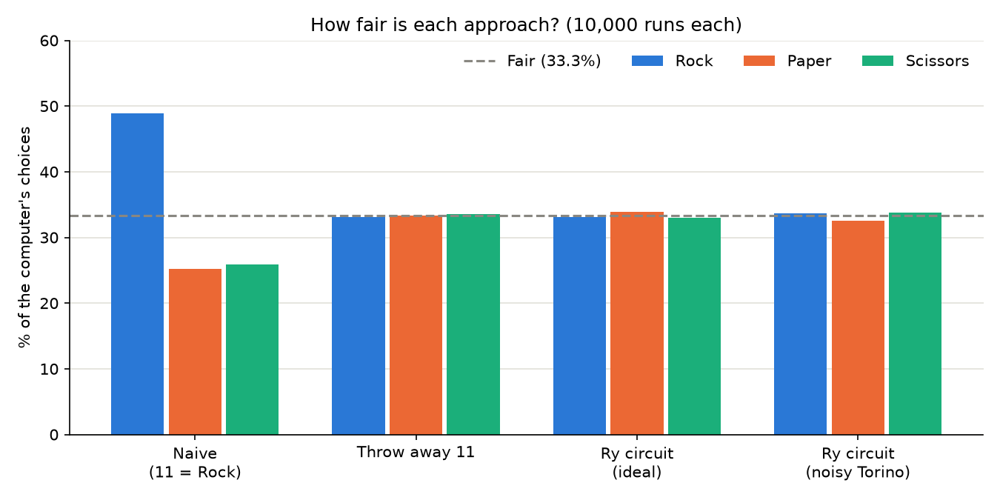

#  Quantum Rock, Paper, Scissors

**Qiskit Fall Fest Nairobi 2026 · Challenge 07** · by Ian Kamau

A Rock, Paper, Scissors game where the computer's choice comes from measuring qubits instead of a classical random number generator. Built with Qiskit 2.5 on qBraid.

👉 **[Open the notebook](quantum_rps.ipynb)**: all the code, results and explanations

🎬 **Promo video:**

https://github.com/user-attachments/assets/f530c34f-847d-41b2-8e63-af5c8e76cd04

## The problem
Two qubits give 4 results (`00`, `01`, `10`, `11`), but the game only has 3 choices: Rock = `00`, Paper = `01`, Scissors = `10`. What do you do with `11`?

## The approaches I compared (10,000 shots each)

| Approach | Rock | Paper | Scissors | Wasted runs | Verdict |
|---|---|---|---|---|---|
| 1. Treat `11` as Rock | 48.9% | 25.2% | 25.9% | 0 | ❌ Unfair: always play Paper to win |
| 2. Throw away `11` and measure again | 33.1% | 33.3% | 33.6% | ≈ 25% | ✅ Fair, but wasteful |
| 3. `Ry` + controlled-H circuit | 33.1% | 33.9% | 33.0% | 0 | ✅ Fair by design |
| 3 on a noisy simulated IBM Torino | 33.4% | 32.3% | 33.5% | 0.7% (`11`) | ✅ Noise brings `11` back, so the game keeps a safety net |
| 3 on real hardware (ibm_fez) | 34.3% | 32.9% | 32.2% | 0.6% (`11`) | ✅ Real 156-qubit IBM quantum computer: matches the simulator |

*The chart shows the first four rows; the real-hardware run is in section 7b of the notebook.*

## How approach 3 works
1. **`Ry(θ)` on qubit 0**, with θ = 2·arccos(√(2/3)) ≈ 70.5°: qubit 0 becomes `0` with probability 2/3 and `1` with probability 1/3.
2. **Controlled-H on qubit 1, only when qubit 0 is `0`.**

So `01` (Paper) gets 1/3, and the other 2/3 splits evenly into `00` (Rock) and `10` (Scissors). In an ideal circuit, `11` is impossible.

## The game
- One fresh quantum measurement (`shots=1`) per round
- Multiple rounds with a live score, win rate, choice statistics and round-by-round history
- Safety net: if noise ever produces `11`, the computer measures again

## Run it yourself
Open `quantum_rps.ipynb` in qBraid Lab (Qiskit environment), or any Jupyter setup with `qiskit`, `qiskit-aer`, `qiskit-ibm-runtime` and `matplotlib`. Run the cells from top to bottom; the game cells ask for your move in a text box. The real-hardware cells (section 7b) also need a free IBM Quantum account with a saved API key.

## What I learned
- Small samples look uneven. Judging fairness takes thousands of shots.
- I ran it on **ibm_fez**, a real 156-qubit IBM quantum computer: `11` appeared 0.6% of the time, close to the simulator's 0.7%.
- Designing the quantum state directly, instead of fixing results afterwards, gave a fair game with nothing wasted.
- **What surprised me most:** I didn't expect a computer to give a result that should be impossible. Noise made `11` appear even though my circuit can't produce it.

## AI disclosure
I used Claude (Anthropic) as a tutor and coding partner: to learn the concepts, get code suggestions with explanations, and word the write-up. I ran, tested and analysed everything myself in qBraid, and all results come from my own runs. I also used Claude Code with the brag plugin to make the promo video. Full details are in the notebook's last section.
